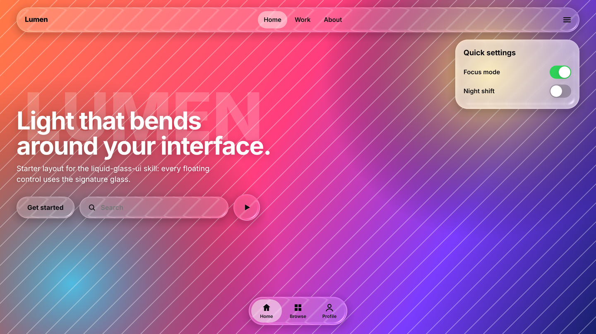
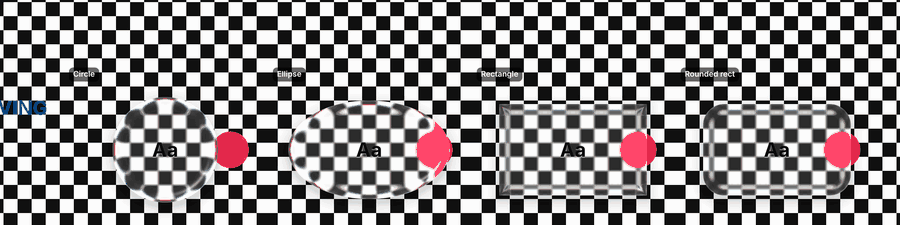
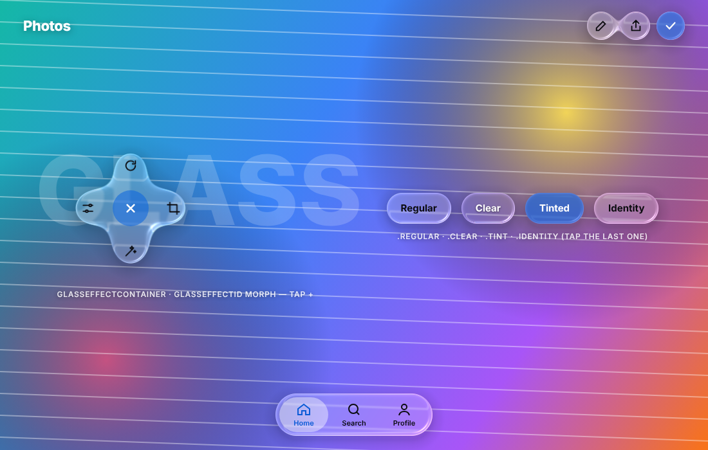
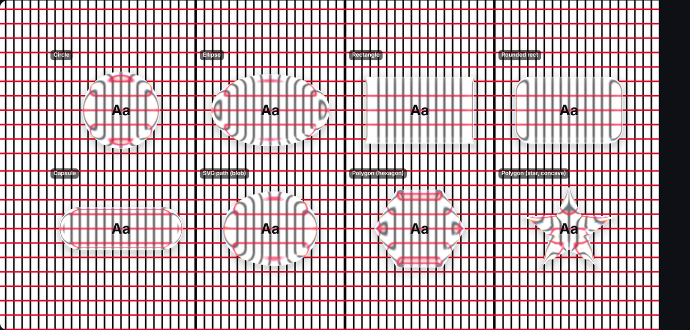
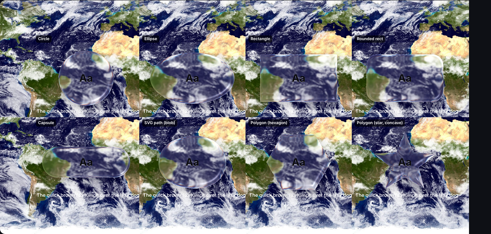
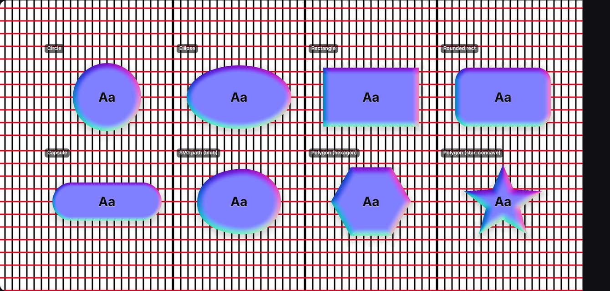
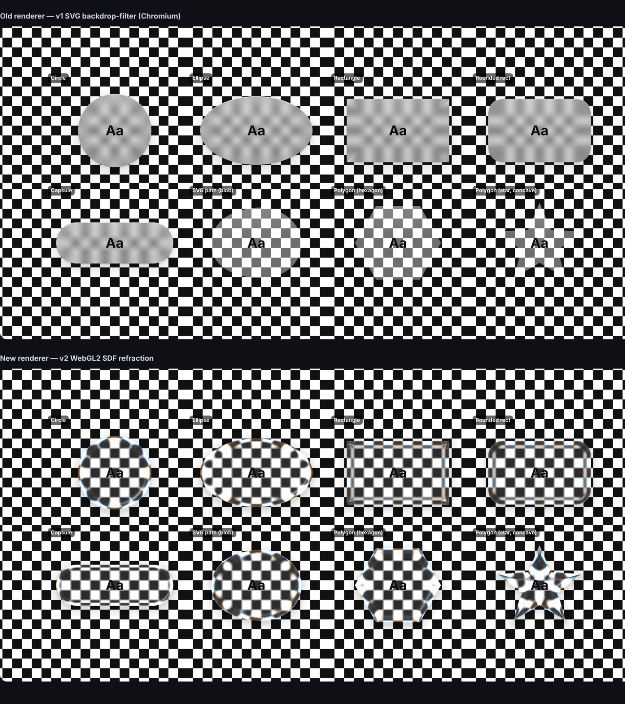

<div align="center">

# Liquid Glass Lab

**Glass that actually bends light — a WebGL2 refraction engine, design system and Claude skill for Liquid Glass-style UI.**

[](https://github.com/TheTechBot/liquid-glass-lab/actions/workflows/ci.yml)
[](https://thetechbot.github.io/liquid-glass-lab/)


[**Live demo**](https://thetechbot.github.io/liquid-glass-lab/) · [**Refraction Lab**](https://thetechbot.github.io/liquid-glass-lab/lab.html) · [**Starter**](https://thetechbot.github.io/liquid-glass-lab/starter.html) · [**Glass API**](https://thetechbot.github.io/liquid-glass-lab/glass.html) · [Docs](design-system/SPEC.md)



</div>

---

## Why

Most "liquid glass" on the web is `backdrop-filter: blur()` plus a white border. That is frosted glass, not glass. Real glass **bends** what is behind it — strongest at the rim, calm in the middle.

This project renders that bend per pixel:

- **Real backdrop sampling** — the pixels behind the glass move; nothing is faked with noise.
- **Shape-aware** — signed distance fields for circle, ellipse, rect, rounded rect, capsule, SVG paths and polygons (concave too).
- **Smooth corners** — normals come from a smoothed field, depth from the true edge. No creases.
- **Material model** — refractive index, thickness, curvature, Fresnel, rim light, internal reflection, tint, dispersion, shadow.
- **Mirror-symmetric** and **frame-synced** with moving backgrounds (tested).
- **Accessible by default** — Reduce Transparency, Increase Contrast and forced colours switch to an accessible fallback automatically.

<p align="center"></p>

## Quick start

No build needed — open a single-file demo in Chrome or Edge:

| File | What |
|---|---|
| [`implementations/web/dist/liquid-glass-starter.html`](implementations/web/dist/liquid-glass-starter.html) | Starter page for new UIs |
| [`implementations/web/dist/refraction-lab.html`](implementations/web/dist/refraction-lab.html) | Refraction Test Lab with every parameter |
| [`implementations/web/dist/liquid-glass-demo.html`](implementations/web/dist/liquid-glass-demo.html) | Full app demo (tab bar, menus, sheets, controls) |
| [`implementations/web/dist/liquid-glass-effect-demo.html`](implementations/web/dist/liquid-glass-effect-demo.html) | SwiftUI-style API: `glassEffect`, `GlassEffectContainer`, morphing |

### Use it in a page

```html
<link rel="stylesheet" href="liquid-glass.css">
<canvas id="scene" data-lg-backdrop-source></canvas>   <!-- or  / <video> -->

<nav class="lg-glass" data-lg-glass data-lg-preset="control">…</nav>
<button class="lg-glass" data-lg-glass data-lg-interactive aria-label="Play">▶</button>

<script src="liquid-glass.iife.js"></script>
<script src="liquid-glass-refraction.iife.js"></script>
<script>
  LG.init();                                         // layout, press flex, accessibility fallback
  LGRefraction.autoAttach(document, { observe: true }); // signature refraction on every [data-lg-glass]
</script>
```

Shape is read from `border-radius` (circle, ellipse, capsule, rounded rect, rect). Files live in [`implementations/web/dist/`](implementations/web/dist).

### Programmatic

```js
const glass = LGRefraction.attach(el, {
  backdrop: canvas,                                    // canvas | img | video
  shape: { type: 'path', d: 'M100 8C150 4…Z', viewBox: [0, 0, 200, 160] },
  preset: 'control',
  material: { blur: 4 },
});
glass.update({ material: { ior: 1.6 } });
glass.destroy();
```

### React

```tsx
import { LiquidGlassProvider, GlassGroup, GlassButton } from './liquid-glass';

<LiquidGlassProvider>
  <canvas ref={sceneRef} />
  <GlassGroup refraction={{ backdrop: sceneRef, preset: 'control' }}>…</GlassGroup>
  <GlassButton refraction={{ backdrop: sceneRef }} aria-label="Play" icon={<PlayIcon />} />
</LiquidGlassProvider>
```

Components: `GlassSurface`, `GlassButton`, `GlassGroup`, `FloatingTabBar`, `GlassMenu`, `FloatingPanel`, `SegmentedControl`, `GlassSlider`, `GlassToggle`, `ScrollEdge`. Source in [`implementations/react`](implementations/react).

## SwiftUI-style API on the web

The same names as Apple's iOS 26 API: `glassEffect`, `Glass.regular / .clear / .identity`, `.tint()`, `.interactive()`, `GlassEffectContainer(spacing:)`, `glassEffectID` morphing.



```html
<div data-glass-container="30">                       <!-- GlassEffectContainer(spacing: 30) -->
  <button data-glass data-glass-tint="#0a64e0" data-glass-interactive data-glass-id="toggle">+</button>
</div>
<button data-glass="clear">Clear</button>               <!-- .glassEffect(.clear) -->
<script>LG.init(); LGGlass.autoGlass(document);</script>
```
```js
import { Glass, glassEffect, glassEffectContainer } from './liquid-glass-effect.js';
glassEffect(button, Glass.regular.tint('#0a64e0').interactive(), { in: 'circle' });
const box = glassEffectContainer(el, { spacing: 30 });
box.withAnimation(() => el.append(newButton));          // withAnimation(.bouncy) { … }
```
Glass inside a container is drawn as **one** surface, so nearby shapes fuse like droplets and new shapes grow out of their neighbours. React: `<GlassEffect>`, `<GlassEffectContainer>`, `useGlassAnimation`. This is an approximation built on our engine, not Apple's renderer.

## The signature preset

The default look for every shape, tuned by eye in the Refraction Lab:

```json
{ "profile": "rim", "ior": 1.51, "thickness": 31, "curvature": 0.25, "refraction": 1, "edge": 0.81, "fresnel": 0.92,
  "blur": 2.5, "tint": "rgba(255,255,255,0.11)", "reflection": 0.41, "dispersion": 0.015, "shadow": 0.25, "lightAngle": 50, "maxOffset": 0.9 }
```

| Preset | For | Difference |
|---|---|---|
| `signature` | icon buttons, FABs | — |
| `control` | nav bars, tab bars, labelled buttons | tint 16% |
| `media` | controls over photos / video | dark tint 28% |
| `overlay`, `overlay-dark` | menus, sheets, panels with text | blur 8, tint 55% |

All presets share the same bend, so a whole UI reads as one material.

## Refraction Test Lab

Every shape on identical backgrounds — checkerboard, straight lines, fine grid, gradient, photo, moving — with sliders for every parameter, debug views (normals, UV offset, distance bands) and old-vs-new comparison. **Copy settings** exports JSON you can paste back as a preset.

<table>
<tr>
<td></td>
<td></td>
</tr>
<tr>
<td></td>
<td></td>
</tr>
</table>

<details>
<summary>How the optics work</summary>

Per pixel inside a glass shape:

1. Signed distance `s` to the outline (analytic for primitives; exact Euclidean distance-field texture for paths/polygons).
2. Rim band width `W = curvature × min(halfW, halfH)`, depth `t = clamp(−s / W)`.
3. **Rim profile** (default): offset `= −n̂ · (1 − t)² · thickness · (ior − 1) · 2 · refraction`, clamped to `maxOffset × min(halfW, halfH)`. **Physical profile**: Snell refraction through a circular bevel.
4. Sample the backdrop at the offset, then blur (mirror-symmetric disk kernel), then dispersion.
5. Schlick Fresnel `F0 = ((ior−1)/(ior+1))²`, rim light facing `lightAngle`, internal reflection, tint, shadow, 1-device-pixel antialiasing.

Full spec: [`design-system/SPEC.md` §11](design-system/SPEC.md).
</details>

## Claude skill

[`skill/liquid-glass-ui`](skill/liquid-glass-ui) teaches Claude to build new UIs and restyle existing apps with this look — layer rules, presets, the starter, validation. Upload [`skill/liquid-glass-ui-skill.zip`](skill/liquid-glass-ui-skill.zip) as a skill in Claude, then ask for any UI.

## Platforms

| Platform | Glass | Status |
|---|---|---|
| Web (Chrome / Edge) | WebGL2 engine (this repo) | tested headless Chrome |
| React | same engine via components | typecheck + build + smoke tested |
| Web over plain DOM content | SVG `backdrop-filter` refraction (Chromium) or blur | tested |
| SwiftUI (iOS / macOS 26) | Apple's real `glassEffect` via `LiquidGlassKit` | source only, **not compiled yet** — see [VALIDATION](implementations/swiftui/VALIDATION.md) |
| React Native | real glass on iOS 26 (`expo-glass-effect`), fallbacks elsewhere | typecheck only |

Firefox and Safari are **not tested**. WebGL refracts only drawable backdrops (`<canvas>`, ``, `<video>`) — that is a browser limit.

## Tests

```bash
npm run setup:tests   # once: installs Playwright + axe-core in validation/
npm run build
npm test              # refraction engine (24) + web demo (37) + glass API (13 checks)
npm run test:react    # React typecheck, build, smoke (10 checks)
```

The engine checks cover: rim bending, centre stays flat, offsets follow the shape normal, continuous normals at corners, all parameters × all shapes, frame sync with moving backgrounds, mirror symmetry, resize, scroll, DPR 1/2, no-WebGL2 fallback, accessibility fallbacks, and that refraction is measurably different from blur. Report: [`validation/REPORT.md`](validation/REPORT.md).

Tests run on a software GPU in CI, so they prove correctness, not speed. Measure frame time on your own hardware before using many glass surfaces.

## Project layout

```
design-system/         SPEC.md, tokens (generated to CSS / TS / Swift)
implementations/web/   engine (src/), demo, refraction-lab, starter, single-file builds (dist/)
implementations/react/ components + demo
implementations/swiftui/ LiquidGlassKit (Apple glassEffect wrappers) + demo app
implementations/react-native/ platform-aware components
skill/liquid-glass-ui/ Claude skill (SKILL.md, assets, references, audit script)
research/              Apple sources, analysis, limitations, refraction investigation
validation/            Playwright + axe test suites, results, screenshots
site/                  GitHub Pages landing
```

## Rollback

Each glass surface can fall back at runtime: add `?renderer=svg` (or `blur`) to the page URL, or call `LGRefraction.disableAll()`. The v1 SVG renderer stays in `liquid-glass.js`.

## Credits

- Built with research from Apple's public [Liquid Glass documentation](https://developer.apple.com/documentation/TechnologyOverviews/adopting-liquid-glass) and WWDC25 "Meet Liquid Glass". See [`research/evidence-log.md`](research/evidence-log.md).
- Lab photo: NASA Blue Marble (public domain).
- **Not affiliated with Apple.** "Liquid Glass" is Apple's name for its material; this is an independent, physically inspired approximation.

## License

[MIT](LICENSE) © 2026 TheTechBot
